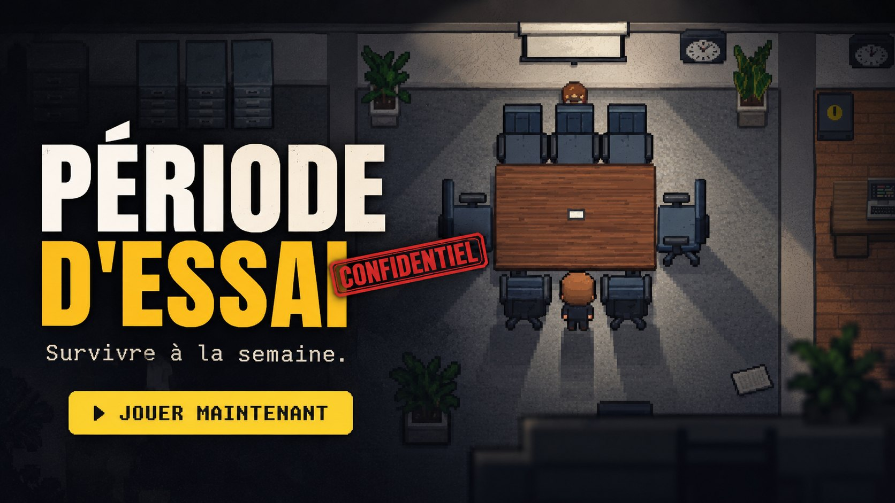

# PÉRIODE D'ESSAI — Survivre à la semaine.

Premier jour au bureau, premier cadavre. Fais ton boulot pour monter en grade, fouille en douce pour démasquer l'assassin de Bernard… et survis jusqu'au vendredi.

- 5 journées + 3 soirées d'infiltration, environ 1 h 30 de jeu
- Mini-jeux de bureau, enquête en images, accusation finale, fin cachée
- Jeu web en HTML5 / Canvas, sans dépendance

**Commandes** : ZQSD / flèches · E / Espace · TAB (carnet) · Échap (pause) · M (son)

## Crédits
- Un jeu **PLUME PLAYLAB**
- Graphismes : « Office Pixel Art » par [Imersa Studios](https://imersastudios.itch.io/office-pixel-art)
- Polices : Anton, Space Grotesk, JetBrains Mono, Special Elite (SIL Open Font License)
- Musique et sons générés dans le jeu
